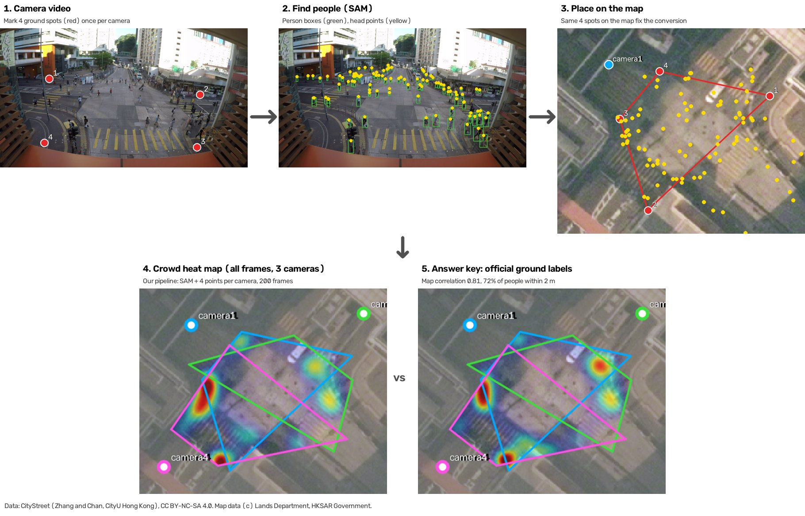
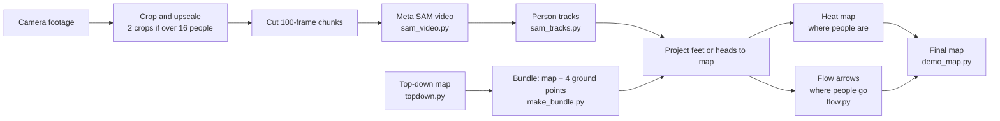

# Campus Flow

Campus Flow maps how people walk through a place, using ordinary camera footage. It turns video into crowd heat maps and flow arrows on a top-down map, to help plan transit and crowd safety. We build and test it on EPFL’s SCOUT campus data. SCOUT images stay private, so public figures and demos use the CityStreet dataset.

## How it works

1. **Camera video.** For each camera, a person marks four spots on flat ground once, such as crosswalk corners.
2. **Find people.** The hosted SAM 3.1 model finds every person in each frame. Each person gives one point: the feet for low cameras, the head for high cameras in crowds. SAM follows at most 16 people per video frame, so a busy view is split into overlapping crops, and each person is counted in one crop only.
3. **Place on the map.** The same four spots marked on a top-down map fix a conversion from camera pixels to map pixels. Every person is placed on the map with it.
4. **Crowd heat map.** People from all frames and cameras add up to people per square meter. Ground no camera sees stays gray. Tracks of people over time give flow arrows (not shown here).
5. **Check.** On CityStreet, the result matches the official ground labels: map correlation 0.81, and 72% of people placed within 2 m.

The figure uses CityStreet, because the SCOUT terms do not allow sharing SCOUT images. The same pipeline runs on the SCOUT campus cameras. `services/perception/citystreet/readme_figure.py` rebuilds the figure.

## Data credits

Campus Flow uses the [SCOUT dataset](https://scout.epfl.ch/) from EPFL’s Computer Vision Laboratory (CVLAB), including video, camera calibration, and scene geometry.

Dataset reference: Martin Engilberge, Ivan Vrkic, Friedrich Wilke Grosche, Julien Pilet, Engin Turetken, and Pascal Fua. *[One Graph to Track Them All: Dynamic GNNs for Single- and Multi-View Tracking](https://arxiv.org/abs/2507.08494)* (2025).

SCOUT is available for academic and research use under its [terms of use](https://scout.epfl.ch/download). Dataset files are not included in this repository; teammates should request access directly from SCOUT.

The [CityStreet dataset](https://visal.cs.cityu.edu.hk/research/citystreet/) from City University of Hong Kong's VISAL lab supplies a denser crowd for testing. It contains 500 synchronized multi-view frames of a busy Hong Kong street intersection, with camera calibration and ground-plane people labels. CityStreet is released under [CC BY-NC-SA 4.0](https://creativecommons.org/licenses/by-nc-sa/4.0/) and its bundled copyright notice.

Dataset reference: Qi Zhang and Antoni B. Chan. *[Wide-Area Crowd Counting via Ground-Plane Density Maps and Multi-View Fusion CNNs](https://arxiv.org/abs/2012.00946)* (CVPR 2019).

To download CityStreet from its official source into the ignored `data/citystreet/` folder, run `scripts/get-citystreet.sh`. The script requires [uv](https://docs.astral.sh/uv/) and about 32 GB of free disk space. It skips the DukeMTMC and PETS2009 archives bundled in the same folder.

## Input format

The flow map pipeline takes a top-down map, the camera footage, and four or more hand-marked ground points per camera. It outputs a crowd heat map on that map. The input format is version 0.1 and may change. See [`services/perception/flowmap/README.md`](services/perception/flowmap/README.md).

## Temporary pipeline

This is the current working pipeline. It will change.

- Final output: flow arrows over the heat map.
- Heat shows where people gather. Arrows show which way they walk.

- Each step caches its output. Reruns skip finished chunks.
- Chunks are 100 frames. SAM picks people early, then stops finding new ones.
- SAM tracks at most 16 people per frame. Busy scenes use 2 crops.
- `--budget` caps spend. Network errors resume. API errors stop the run.
- Scripts live in `services/perception/scout/` and `services/perception/flowmap/`.

- One chunk takes about 10 s of SAM time.
- A full run is slow for two reasons: the 10 s pause and `cut()`.
- `cut()` decodes from frame 0 every time. Late chunks take longest.
- Fix planned: cut all chunks in one ffmpeg pass.

## Contributing

Open tasks you can pick up are in [`CONTRIBUTING.md`](CONTRIBUTING.md).
